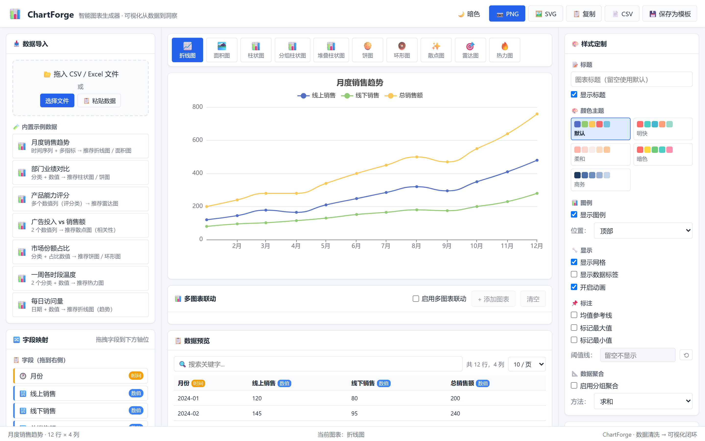
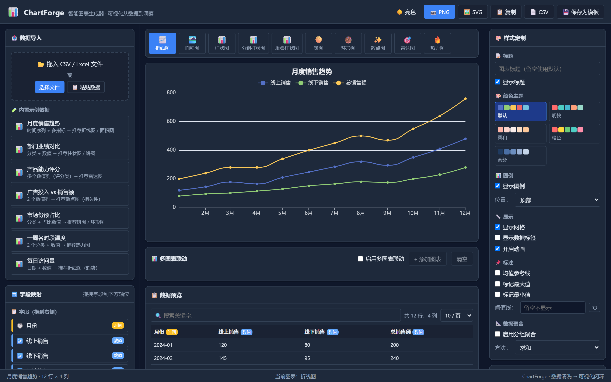
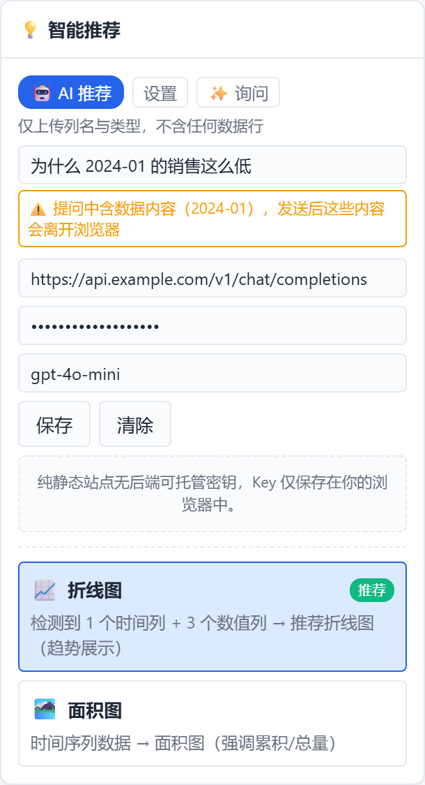

# ChartForge

纯前端 ECharts 图表构建器。拖入 CSV / XLSX，自动识别列类型并推荐图表，
支持多图仪表盘、模板复用与 PNG / SVG / CSV 导出。

**无后端、无构建步骤、无依赖安装**——直接用浏览器打开 `index.html` 即可运行。

## 这个项目想证明什么

1. **纯静态也能做完整的数据工具** —— 无后端、无构建、无 npm install，
   打开 `index.html` 就跑，但功能覆盖导入 → 类型推断 → 推荐 → 映射 → 导出全链路。
2. **隐私边界要能被测试，而不是写在 README 里** —— 接入 LLM 时只发送数据结构，
   并且用一条会遍历每个单元格值的断言把这条边界钉死（下面有变异测试记录）。
3. **测试要能抓到真 bug** —— 这套断言在开发中确实抓出过自己写的空洞断言，
   以及一个时间轴渲染缺陷（Y 值被当成时间戳）。



<details>
<summary>暗色主题 / AI 推荐面板截图</summary>



AI 面板：注意「仅上传列名与类型」说明、实时隐私警告、以及对 BYO key 局限的直说。



</details>

> **在线预览（GitHub Pages）**
>
> 本项目是零构建静态站点，`index.html` 位于**仓库根目录**，因此在
> Settings → Pages 里要选 **Branch: main / 目录 `/ (root)`**，
> *不要*选 `/docs` —— `docs/` 只存放 README 截图，没有 `index.html`，选它会 404。
>
> 开启后地址即 `https://<用户名>.github.io/<仓库名>/`。
> 部署的 demo 默认不带 API key，走本地规则引擎，功能完整。


## 数据不出浏览器

所有解析、渲染、持久化都在本地完成。文件不上传，数据不出网。
持久化只用 `localStorage`（见 `js/store.js`，带版本号，数据结构变更时旧存档自动失效）。

唯一的对外网络请求是可选的 AI 推荐，且**只发送数据结构，不发送任何数据行**——
见下节。

## 图表推荐：两种 provider，同一个接口

`js/advisor.js` 把「给我一份图表配置」抽象成 provider：

| provider | 实现 | 是否需要网络 |
| --- | --- | --- |
| `rules` | `js/recommend.js` 规则引擎，按列类型组合匹配 | 否 |
| `llm` | 任意 OpenAI 兼容端点（自带 key） | 是 |

两者输出**完全同构**的结构，下游不需要知道建议从哪来。

`rules` 是默认路径，也是**兜底路径**：没有配置 key、请求失败、模型返回了
非法内容——任何一种情况都静默退回规则引擎，功能不残废。

### 只发 schema，且这条边界是可测的

发给模型的全部内容就是 `Advisor.buildSchema()` 的输出：列名、列类型、行数、
可选图表类型清单。约 200 字节，不含任何单元格值。

这不只是一句承诺。`tools/diag.py` 里有一条断言会拦截 `fetch`，
把请求体和数据集中**每一个单元格值**逐个比对，出现任何一个即判定失败：

```
[OK] 请求体不含任何数据行的单元格值（隐私边界）
```

这条断言做过变异测试：在 prompt 里故意附加 3 行样例数据后，它是 217 项中
唯一失败的一项，并打印出泄漏的具体值。

明确**不做**「自动数据洞察」类功能——那必须外发真实数值，与上述前提直接冲突。

### 自然语言提问：唯一的边界缺口，做了知情提示

输入框允许自由提问（「按月对比收入和支出」）。这段文本会原样发出，
因此它是 schema-only 边界唯一绕不过去的缺口——如果用户自己把真实数值
粘进去（「为什么 2024-01 的 480 这么高」），边界就失效了。

处理方式是**实时自检 + 提示，但不拦截**：输入时比对数据集单元格值，命中即
显示警告，说明这些内容会离开浏览器。用户有权决定发什么，工具的责任是让他知情。

自检只比对单元格值、不比对列名（列名本来就在 schema 里），且对长度 < 4 的值
不做匹配，否则「前 12 个月」这类正常提问会被误判。

### 模型输出一律当作不可信输入

LLM 可能返回越界的列索引（数据 5 列却给 `y:[7]`）或不存在的图表类型。
这与「从 localStorage 读到过时的看板配置」是同一类问题，因此走同一套校验思路
（`Advisor.validateSuggestion` / `Dashboard._fieldsValid`）：任何一项不合法就
整条丢弃，宁可退回规则引擎，也不画错图。

### API key 的存放：已知限制

纯静态站点没有后端可以托管密钥，因此只能由用户自带、存在自己浏览器的
`localStorage` 里（BYO key）。**这是无后端架构的固有限制，本项目不假装解决了它。**

因此：
- 部署在 GitHub Pages 上的 demo 默认不带 key，走规则引擎；
- key 不会写入模板、看板存档或任何导出文件（有断言覆盖）；
- 建议使用有额度上限的测试 key。

## 使用

```
# 任选一种静态服务方式
python -m http.server 8000
# 然后访问 http://localhost:8000
```

直接双击 `index.html` 也能用，仅本地文件读取受浏览器 `file://` 限制影响。

## 测试

```
pip install playwright && playwright install chromium
python tools/diag.py
```

217 项端到端断言（Playwright + 真实 Chromium），覆盖导入、类型识别、
各图表渲染、字段映射、仪表盘持久化、标注、导出、AI 建议层与响应式布局。
同时收集 JS 运行时错误与 CSS 结构问题，任一非空即失败。

### 这套断言抓到过什么

不是为了凑数字。两个真实案例：

- **一条空洞断言。** 「点击 AI 建议能渲染出对应图表」原先用 mock 返回 `line`，
  而被测样例本身就是时间序列、默认已经是 `line` —— 前后同值，等于什么都没验证。
  改成 mock 返回 `bar` 并断言 `line → bar` 及字段映射同步生效后才有意义。
- **一个时间轴渲染缺陷。** 折线图对时间列设了 `xAxis.type='time'`，但仍按分类轴
  只把 Y 标量放进 `series.data`。ECharts 的时间轴会忽略 `xAxis.data`，于是
  `120` 被当成时间戳（epoch 120 毫秒），X 轴刻度退化成 `08:00:00 080`，
  三条线被压成假直线。修复后补了断言校验 `series.data` 是 `[时间戳, 值]`
  且年份落在合理区间；反向变异验证过它确实会失败并报出 `bad:120`。

## 目录

```
index.html
css/style.css
js/
  store.js          版本化 localStorage 层
  utils.js          通用工具（格式化 / 转义 / toast）
  importer.js       CSV / XLSX 解析
  datasource.js     数据集与列类型推断
  sample-data.js    内置示例数据
  recommend.js      规则推荐引擎
  advisor.js        推荐 provider 抽象 + LLM 接入 + 输出校验
  chart-renderer.js ECharts option 构建
  chart-dashboard.js 多图仪表盘与布局持久化
  data-table.js     数据表格与排序
  field-mapper.js   字段到图表槽位的映射
  template.js       模板存取
  exporter.js       PNG / SVG / CSV 导出
  app.js            UI 编排
tools/diag.py       端到端断言套件
tools/shots.py      README 截图生成脚本
vendor/             第三方库（ECharts / SheetJS，见 THIRD-PARTY-NOTICES.md）
docs/               README 用截图资产
```

## 运行环境

- **浏览器**：Chrome / Edge / Firefox / Safari 现代版本。JS 侧只用到
  箭头函数、模板字符串、展开语法与 `async/await`（ES2017 级别，未使用
  `?.` / `??`）；CSS 侧依赖自定义属性与 Grid。不支持 IE。
- **运行本身不需要 Python**——Python 只用于跑测试套件和起本地静态服务器。

## 许可

本项目代码采用 [MIT](LICENSE) 许可。

`vendor/` 下内置的第三方库（Apache ECharts、SheetJS，均为 Apache-2.0）
各自适用其原始许可，详见 [THIRD-PARTY-NOTICES.md](THIRD-PARTY-NOTICES.md)。

